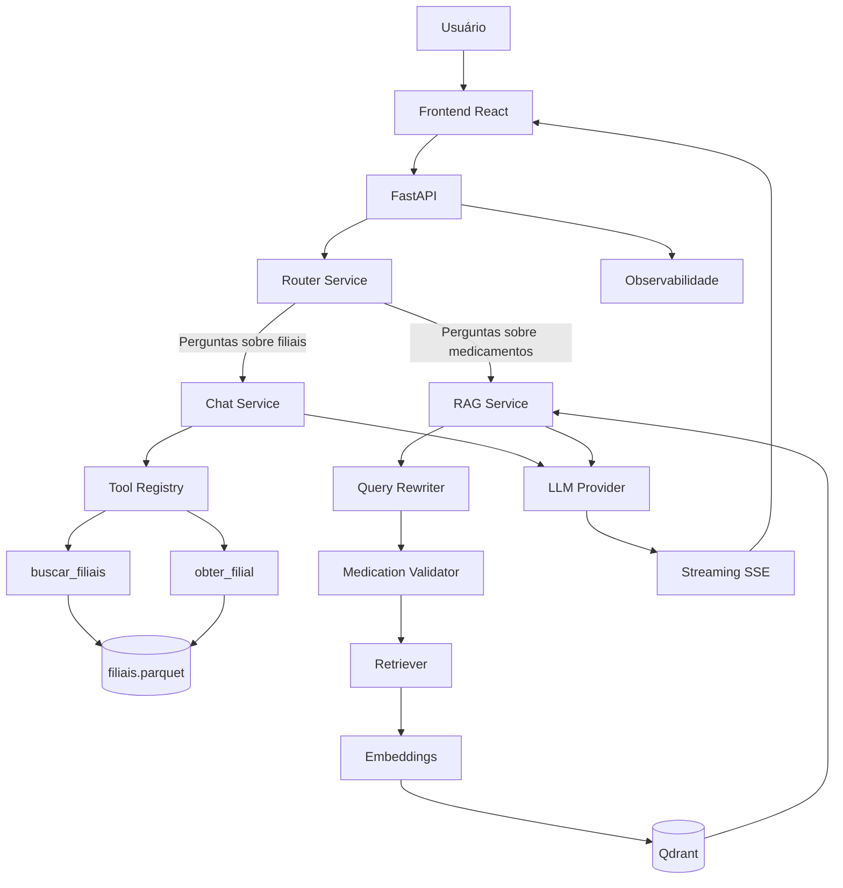

# Arquitetura Técnica — Panvel AI Assistant

## 1. Visão geral

O Panvel AI Assistant é uma aplicação conversacional de Inteligência Artificial Generativa desenvolvida para o desafio técnico do Grupo Panvel.

A solução combina duas estratégias de acesso à informação:

1. **Retrieval-Augmented Generation (RAG):** utilizada para responder perguntas sobre medicamentos com base nas bulas disponibilizadas.
2. **Tool Calling:** utilizada para consultar informações estruturadas sobre filiais da Panvel.

A arquitetura foi projetada para separar responsabilidades, permitir rastreabilidade das respostas e facilitar futuras evoluções.

### Principais tecnologias

| Camada | Tecnologia |
|---|---|
| Frontend | React, TypeScript e Vite |
| Backend | Python e FastAPI |
| Modelo de linguagem | OpenAI GPT-4o-mini |
| Embeddings | OpenAI text-embedding-3-small |
| Banco vetorial | Qdrant |
| Dados estruturados | Pandas e Parquet |
| Comunicação em tempo real | Server-Sent Events (SSE) |
| Validação | Pydantic |
| Testes | Pytest |
| Infraestrutura | Docker e Docker Compose |

---

## 2. Arquitetura geral



A separação entre os fluxos evita utilizar busca vetorial para informações que já estão disponíveis de maneira estruturada.

---

## 3. Organização do backend

O backend foi organizado em módulos com responsabilidades específicas.

```text
backend/app/
├── api/
│   ├── chat.py
│   └── stream.py
│
├── core/
│   ├── config.py
│   └── prompts.py
│
├── llm/
│   ├── base.py
│   ├── factory.py
│   ├── openai_provider.py
│   └── schemas.py
│
├── models/
│   └── chat.py
│
├── observability/
│   ├── logger.py
│   ├── timing.py
│   ├── token_tracker.py
│   └── tracing.py
│
├── rag/
│   ├── chunking.py
│   ├── embeddings.py
│   ├── medication_validator.py
│   ├── medications.py
│   ├── pdf_loader.py
│   ├── query_rewriter.py
│   ├── retriever.py
│   ├── service.py
│   └── vector_store.py
│
├── services/
│   ├── assistant_service.py
│   ├── chat_service.py
│   └── router_service.py
│
└── tools/
    ├── definitions.py
    ├── filiais.py
    ├── registry.py
    └── schemas.py
```

Essa estrutura facilita a manutenção e a criação de testes isolados.

---

## 4. Roteamento de perguntas

O `RouterService` identifica a intenção da pergunta e seleciona um dos fluxos:

- `filiais`: consultas sobre unidades, serviços e características das lojas.
- `bulas`: consultas farmacológicas baseadas nos documentos disponíveis.

O roteamento utiliza um modelo de linguagem com instruções para retornar uma classificação restrita.

### Decisão arquitetural

Foi escolhido um roteador baseado em LLM pela flexibilidade de interpretar perguntas em linguagem natural.

**Vantagem:** permite reconhecer diferentes formas de formular a mesma intenção.

**Trade-off:** adiciona uma chamada ao modelo e, consequentemente, custo e latência.

Uma evolução possível seria combinar regras determinísticas para casos simples com classificação por LLM para perguntas ambíguas.

---

## 5. Pipeline RAG

O fluxo RAG utiliza as bulas fornecidas no desafio.

### 5.1. Ingestão

O processamento inicial envolve:

1. Leitura dos arquivos PDF.
2. Extração do conteúdo textual.
3. Divisão do conteúdo em chunks.
4. Geração de embeddings.
5. Armazenamento no Qdrant.

A ingestão é executada pelo serviço `indexer` definido no Docker Compose.

O índice vetorial é armazenado em volume persistente, permitindo reutilização nas próximas execuções.

### 5.2. Recuperação

Durante uma consulta:

1. A pergunta é contextualizada pelo `QueryRewriter`, quando necessário.
2. O `MedicationValidator` classifica o tipo de solicitação.
3. A pergunta é convertida em embedding.
4. O Qdrant recupera os chunks semanticamente relevantes.
5. Os documentos recuperados são utilizados como contexto para o LLM.

A configuração inclui:

- `RAG_TOP_K`: quantidade máxima de chunks recuperados.
- `RAG_SCORE_THRESHOLD`: limiar de relevância aplicado nas consultas correspondentes.

### 5.3. Geração da resposta

O modelo recebe instruções para utilizar exclusivamente as informações presentes nos documentos recuperados.

O objetivo é reduzir respostas sem fundamentação documental.

As fontes identificadas na resposta são disponibilizadas ao frontend.

### Decisão arquitetural

Foi escolhido o RAG em vez de fine-tuning porque o objetivo principal é consultar uma base documental específica.

**Vantagens:**

- Permite atualizar o conhecimento sem treinar novamente o modelo.
- Possibilita rastrear os documentos recuperados.
- Separa conhecimento documental do modelo generativo.

**Trade-offs:**

- A qualidade depende da extração textual e do chunking.
- A recuperação semântica pode retornar trechos incompletos.
- Um documento recuperado não garante, isoladamente, que a resposta esteja correta.
- A identificação das fontes utilizadas ainda depende do conteúdo produzido pelo modelo.

---

## 6. Tool Calling

As informações estruturadas sobre filiais são consultadas por ferramentas específicas.

### Ferramentas disponíveis

**`buscar_filiais`**

Permite consultar filiais utilizando filtros como:

- Localidade.
- Tipo de estabelecimento.
- Delivery.
- Panvel Clinic.
- Estacionamento.
- Atendimento 24 horas.

**`obter_filial`**

Permite consultar informações de uma filial pelo seu código.

### Funcionamento

1. O modelo identifica a necessidade de executar uma ferramenta.
2. Gera uma chamada estruturada com argumentos.
3. O backend valida os argumentos.
4. A ferramenta consulta os dados em `filiais.parquet`.
5. O resultado retorna ao modelo.
6. O modelo produz uma resposta em linguagem natural.

### Segurança

As ferramentas disponíveis são previamente definidas e registradas.

O modelo não recebe permissão para executar comandos arbitrários ou consultas livres ao sistema operacional.

Também existe um limite de iterações para evitar ciclos indefinidos de chamadas.

### Decisão arquitetural

Foi escolhido Tool Calling em vez de RAG para filiais porque os dados possuem estrutura definida.

**Vantagem:** permite filtros precisos e consultas determinísticas.

**Trade-off:** a aplicação precisa manter schemas e ferramentas específicas para cada conjunto de operações.

---

## 7. Contexto conversacional

A API recebe o histórico de mensagens da conversa.

Esse histórico permite interpretar perguntas dependentes de interações anteriores.

Exemplo:

**Usuário:**

> Quais filiais de Londrina possuem estacionamento?

**Usuário, em seguida:**

> Dessas, quais possuem Panvel Clinic?

O assistente pode utilizar o histórico para interpretar a referência "dessas".

No fluxo RAG, o `QueryRewriter` transforma perguntas contextuais em consultas independentes antes da recuperação.

### Limitação

O histórico é enviado pela aplicação cliente.

Não existe, na implementação atual, um banco de dados dedicado à persistência de sessões conversacionais.

---

## 8. Streaming SSE

A aplicação utiliza Server-Sent Events para transmitir respostas ao frontend.

O endpoint de streaming é:

```text
POST /api/chat/stream
```

O fluxo contempla eventos como:

| Evento | Finalidade |
|---|---|
| `metadata` | Informações sobre rota, ferramentas e fontes |
| `content` | Conteúdo textual da resposta |
| `done` | Finalização, latência e consumo de tokens |
| `error` | Comunicação de falhas |

No fluxo RAG, as respostas podem ser transmitidas progressivamente conforme o modelo gera o conteúdo.

### Trade-off

SSE é adequado para comunicação unidirecional do servidor para o cliente.

Para cenários futuros que exijam comunicação bidirecional contínua, WebSockets poderiam ser considerados.

---

## 9. Abstração do provedor LLM

O backend possui uma interface `LLMProvider`, definida em:

```text
backend/app/llm/base.py
```

A implementação atual é:

```text
backend/app/llm/openai_provider.py
```

A seleção do provedor é centralizada em:

```text
backend/app/llm/factory.py
```

Os serviços utilizam a função `create_llm_provider()` em vez de instanciar diretamente a implementação concreta.

### Benefícios

- Redução do acoplamento.
- Facilidade para testes com mocks.
- Centralização da escolha do provedor.
- Possibilidade de adicionar novas implementações.

### Limitação

Atualmente, somente o provedor OpenAI está implementado.

Além disso, a geração de embeddings possui integração própria e precisaria de abstração adicional para permitir substituição completa do fornecedor.

---

## 10. Observabilidade

O sistema registra informações estruturadas por turno de conversa.

Entre os dados registrados estão:

- Trace ID.
- Rota selecionada.
- Latência total.
- Latência por etapa.
- Tokens de entrada e saída.
- Ferramentas executadas.
- Argumentos das ferramentas.
- Documentos recuperados.
- Fontes identificadas.

### Etapas monitoradas

No fluxo RAG, são medidas etapas como:

- `router_ms`
- `query_rewrite_ms`
- `medication_validation_ms`
- `embedding_ms`
- `vector_search_ms`
- `llm_generation_ms`

No fluxo de filiais, são medidas:

- `router_ms`
- `tool_orchestration_ms`

A observabilidade utiliza logs estruturados em JSON.

### Limitação

A etapa `tool_orchestration_ms` ainda agrega diferentes operações, incluindo chamadas ao modelo e execução de ferramentas.

Uma evolução recomendada é separar essas medições.

As métricas atuais também não constituem um sistema completo de monitoramento de produção, com dashboards e alertas.

---

## 11. Segurança e guardrails

O fluxo farmacológico possui mecanismos para reduzir respostas inadequadas.

Entre eles:

1. Classificação de solicitações de orientação individual.
2. Identificação de medicamentos disponíveis no corpus.
3. Restrição da geração ao contexto recuperado.
4. Limiar de relevância na recuperação.
5. Instruções para não recomendar tratamentos individualizados.
6. Identificação das fontes documentais.

### Limitações

Esses mecanismos reduzem riscos, mas não eliminam completamente a possibilidade de respostas incorretas.

O assistente não substitui profissionais de saúde.

Antes de uma implantação real, seriam necessárias avaliações específicas de segurança farmacológica, revisão de respostas críticas e políticas operacionais de uso.

---

## 12. Infraestrutura e execução

A aplicação utiliza Docker Compose para orquestrar quatro serviços:

| Serviço | Responsabilidade |
|---|---|
| `qdrant` | Armazenamento e recuperação vetorial |
| `indexer` | Processamento e indexação das bulas |
| `backend` | API e orquestração do assistente |
| `frontend` | Interface conversacional |

### Ordem de inicialização

1. Qdrant inicia e passa no health check.
2. Indexer processa ou valida o índice.
3. Backend inicia após a conclusão do indexer.
4. Frontend inicia após o backend estar saudável.

A execução local é realizada com:

```bash
docker compose up --build
```

O armazenamento vetorial utiliza um volume persistente.

### Trade-off

Docker Compose simplifica a execução e a avaliação local do desafio.

Para ambientes de produção com maior escala, seriam necessárias decisões adicionais sobre orquestração, disponibilidade, gerenciamento de segredos e monitoramento.

---

## 13. Testes

O backend utiliza Pytest.

A suíte contempla testes relacionados a:

- Endpoints.
- Ferramentas.
- Validação de argumentos.
- Roteamento.
- Processamento de documentos.
- Guardrails.
- Observabilidade.
- Factory do provedor LLM.

Integrações externas podem ser simuladas com mocks para evitar chamadas desnecessárias à API durante os testes.

A execução é realizada com:

```bash
cd backend
pytest -q
```

---

## 14. Limitações conhecidas

A implementação atual possui limitações assumidas:

1. Apenas o provedor OpenAI está implementado.
2. A geração de embeddings ainda depende diretamente da OpenAI.
3. Não existe persistência de sessões conversacionais no servidor.
4. Não existe autenticação de usuários.
5. Não existe painel de monitoramento operacional.
6. A validação das citações não comprova automaticamente cada afirmação gerada.
7. A avaliação de qualidade do RAG ainda pode ser ampliada com um conjunto de perguntas e respostas de referência.
8. A latência de Tool Calling ainda não é separada por chamada individual.
9. A aplicação foi preparada para execução local, não para implantação imediata em produção.

Essas limitações são pontos de evolução, não impedimentos para a demonstração do desafio técnico.

---

## 15. Conclusão

A arquitetura combina RAG e Tool Calling para tratar adequadamente dois tipos diferentes de informação.

A solução prioriza:

- Separação de responsabilidades.
- Rastreabilidade.
- Validação de entradas.
- Respostas fundamentadas em documentos.
- Modularidade.
- Facilidade de execução.
- Possibilidade de evolução.
